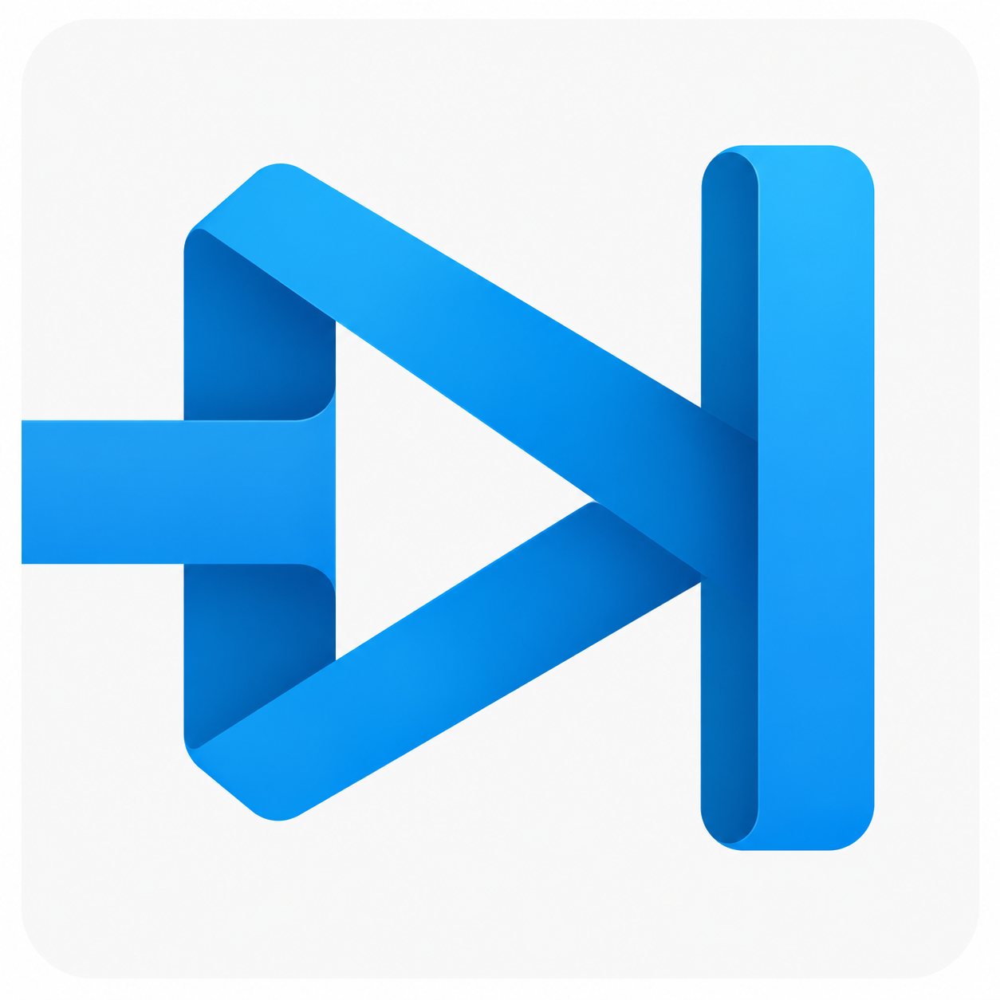
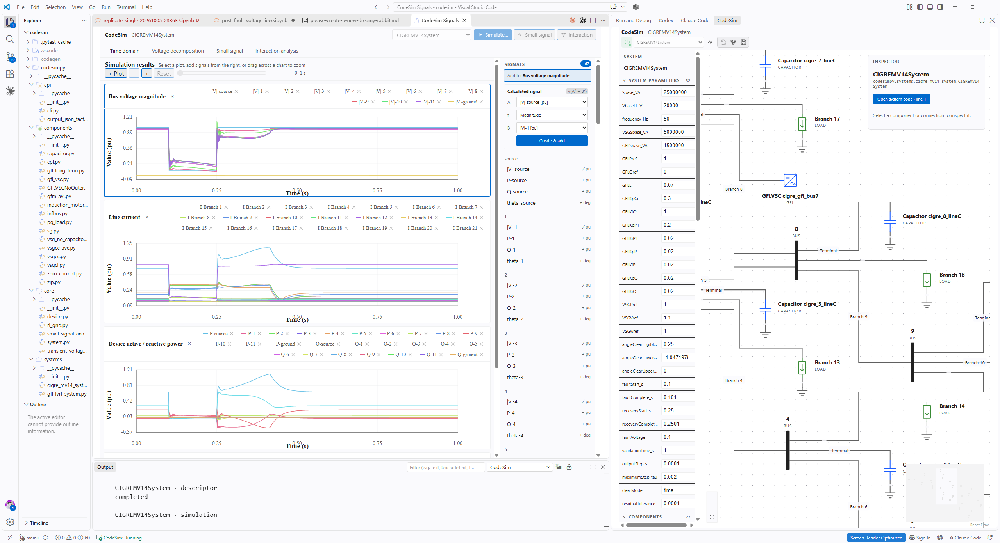
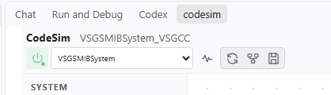

<p align="center">
  
</p>

# CodeSim VS Code extension

The CodeSim System Viewer is the VS Code front end for [CodeSim](https://github.com/NoClassDefError/codesim). It hosts the CodeSim Python backend and provides React webviews for topology, parameters, signals, small-signal results, and interaction analysis.

This repository contains only the extension. The Python backend (`codesimpy`) lives in the main CodeSim repository and is installed separately, either with `pip install codesimpy` or as a source checkout.



## Requirements

- VS Code 1.140 or newer.
- The [Microsoft Python extension](https://marketplace.visualstudio.com/items?itemName=ms-python.python) (installed automatically as a dependency).
- A Python environment in which `codesimpy` is importable: installed with pip, or available as a source checkout.

## Getting started

1. Install the extension (see [Development](#development) to build a VSIX).
2. Install the backend into a Python environment with `pip install codesimpy`, then run `Python: Select Interpreter` and choose that environment.
3. Run `CodeSim: Select Backend` (or click the backend path in the sidebar) and choose **Installed package (pip)**, **Source checkout…**, or **Automatic**.
4. Open the **CodeSim** activity-bar container and press the power button to start the backend.
5. Pick a system from the drop-down; it loads immediately.



## Commands

| Command | Purpose |
| --- | --- |
| `codesim: Open System Viewer` | Focus the topology view |
| `codesim: Open Signals` | Open the signals and analysis panel |
| `CodeSim: Select Backend` | Use the pip-installed `codesimpy`, a source checkout (project root or its `codesimpy` directory), or automatic detection |
| `CodeSim: Select User Workspace Folder` | Select the folder scanned for user-defined `@system` classes |

## Settings

| Setting | Default | Purpose |
| --- | --- | --- |
| `codesim-frontend.backendPath` | empty | Source checkout containing the `codesimpy` package. When empty or unavailable, the open workspace folders are checked. Leave empty to use a pip-installed backend. |
| `codesim-frontend.useInstalledBackend` | `false` | Always run the `codesimpy` installed in the selected interpreter, ignoring `backendPath` and workspace checkouts. |
| `codesim-frontend.userWorkspace` | empty | Folder scanned for user-defined `@system` classes. Empty uses the first workspace folder; relative paths are resolved against it. |

The extension uses the interpreter selected by the Microsoft Python extension for the current workspace. There is no separate `pythonExecutable` setting; after changing the interpreter, restart the CodeSim backend.

### Backend discovery

When the backend starts, the extension looks for it in this order:

1. A source checkout at `codesim-frontend.backendPath`.
2. A source checkout in an open workspace folder (or its `codesim` subfolder).
3. A `codesimpy` package installed in the selected interpreter (for example with pip). It is detected by checking whether that interpreter can import `codesimpy.api.cli`. The backend then runs in the user workspace folder.

A source checkout takes precedence, so local edits are used during backend development. The Output panel (**CodeSim** channel) logs which backend was chosen.

## Runtime flow

1. The topology power button starts `<selected Python interpreter> -u -m codesimpy.api.cli`.
2. The extension sends line-delimited JSON requests through stdin.
3. It reads responses and live simulation events from stdout.
4. Webview messages update topology, parameters, plots, and analysis panels.
5. The stop button sends `server.shutdown` before terminating the process.

The snapshot remains a persistent artifact; normal frontend/backend communication does not poll files from disk.

## Interface behavior

- **System Viewer** shows backend power, system selection, Signals, refresh, automatic layout, and save-layout actions, plus the system parameter editor and component inspector.
- The VS Code status bar shows whether the Python backend is stopped or running; the CodeSim indicator turns green while the backend process is active.
- **Signals View** contains Simulate, Small signal, and Interaction analysis actions, with tabs for time-domain results, voltage decomposition, small signal, and interaction analysis.
- Four plots are created by default: bus voltage magnitude, line current, device active/reactive power, and bus voltage angle.
- Users can add or close plots, select a plot, and assign signals from the right-hand list.
- Trace colors are distinct within each plot.
- Calculated signals can derive magnitude, power, or error from two chosen signals.
- Colors use VS Code theme variables for light and dark themes.

## Repository layout

```text
.
├─ src/
│  ├─ extension.ts              Extension activation and Python process host
│  └─ test/                     VS Code extension tests
├─ webview/
│  ├─ index.html                Vite entry page
│  └─ src/
│     ├─ App.tsx                Topology view
│     ├─ SignalsApp.tsx         Signal and analysis view
│     ├─ bridge/                Typed VS Code message bridge
│     ├─ components/            Toolbars, plots, tables, and panels
│     ├─ model/                 Snapshot schema, layout, and view-model conversion
│     └─ styles.css             Theme-aware webview styles
├─ media/                       Extension icon, activity-bar icon, and screenshots
├─ dist/                        Generated webview bundle (not committed)
├─ out/                         Generated extension host JavaScript (not committed)
└─ package.json                 Contributions, settings, and scripts
```

## Development

Install dependencies:

```powershell
npm install
```

Compile the extension host and webview:

```powershell
npm run compile
```

Run static checks and tests:

```powershell
npm run lint
npm test
```

Press `F5` in VS Code to launch an Extension Development Host. `npm run watch` rebuilds the webview once and then recompiles the extension host on change; `npm run dev:webview` serves the webview through Vite.

Build the VSIX:

```powershell
npm run package:vsix
```

The package is written as `codesim-frontend-<version>.vsix` in the repository root.

## Important files

- `src/extension.ts`: backend lifecycle, settings, stdio protocol, snapshots, and VS Code commands.
- `webview/src/components/Toolbar.tsx`: topology and Signals toolbar actions.
- `webview/src/components/WaveformPanel.tsx`: configurable waveform plots.
- `webview/src/components/SignalSidebar.tsx`: signal assignment and calculated signals.
- `webview/src/components/SmallSignalPanel.tsx`: modes and symbolic expressions.
- `webview/src/components/InteractionAnalysisPanel.tsx`: interaction matrices and modal shifts.
- `webview/src/model/flowModel.ts`: converts backend descriptors to topology nodes, connections, and signals.
- `webview/src/model/elkLayout.ts`: automatic topology layout with ELK.

## License

Licensed under the [Apache License, Version 2.0](LICENSE). Bundled third-party components are listed in [THIRD_PARTY_NOTICES](THIRD_PARTY_NOTICES). Use of the CodeSim name and logo is covered by [TRADEMARKS.md](TRADEMARKS.md). To report a vulnerability, see [SECURITY.md](SECURITY.md).
